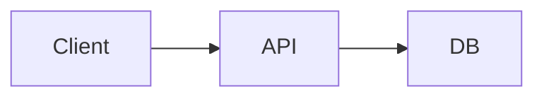

# Contributing to the HelloSmart Knowledge Base

Welcome to the internal contributor guide for the **HelloSmart Product & Engineering Knowledge Base** (`docs-hellosmart`).

This repository is the **Single Source of Truth (SSOT)** for HelloSmart.ai. To maintain high engineering standards and prevent documentation drift, documentation is managed collaboratively across all Team Leads through a strict Pull Request workflow.

---

## 1. Domain Ownership Directory

| Area | Lead Owner | Focus Areas |
|---|---|---|
| **Primary Architecture, QA & Releases** | **Tino** (`@brittytino`) | Platform architecture, QA automation direction, AWS infrastructure, shared contracts, governance, final PR approval, and versioned releases. |
| **Core Backend & Database** | **Vishal V** | Fastify REST API, PostgreSQL 16 schema, Kysely queries, multi-tenancy (BR-01), Task Template blueprints, Razorpay billing. |
| **AI Systems & Proxy** | **Prithivi** | Standalone AI Proxy Gateway (:4000), token spend caps, BYOK vault, Multi-Agent Reviewer pipeline (Archie, Logic, Synergy, Shield, Omni), evidence protocols (BR-19). |
| **QA Team & Test Execution** | **Thiganth & Raja** *(QA Team, led by Tino)* | DAT/QAT testing execution, zero-wait mock harnesses, cross-tenant isolation suites, test matrices. |

---

## 2. Local Development Setup

Prerequisites:
- Node.js >= 20.0.0
- pnpm >= 9.0.0

```bash
# 1. Clone the repository
git clone https://github.com/infinitica-dev/docs-hellosmart.git
cd docs-hellosmart

# 2. Install dependencies
pnpm install

# 3. Start local development server (runs on port 3002)
pnpm dev

# 4. Run production build verification
pnpm build
```

---

## 3. Pull Request Workflow

All documentation changes must be submitted via Pull Requests. Direct commits to `main` are restricted.

### Step 1: Branch Naming Convention
Branches must be created from the latest `main` using the following prefix convention:
- `docs/<lead-name>-<feature-topic>`

Examples:
- `docs/vishal-database-kysely-sync`
- `docs/prithivi-ai-proxy-spend-caps`
- `docs/tino-aws-staging-fargate`
- `docs/qa-dat-qat-protocols`

### Step 2: Commit Messages
Follow Conventional Commits:
- `docs(api): update OpenAPI 3.1 endpoints for candidate autosave`
- `docs(reviewer): add persona specifications for Archie and Logic`
- `docs(infra): document AWS staging ECS cluster and ALB routes`

### Step 3: Open PR & Request Review
- Open a PR targeting `main`.
- The repository's PR template will automatically populate. Complete all checklist items.
- Tag **Tino** (`@brittytino`) for primary review and merge.

---

## 4. Documentation Standards & Style Guide

### 1. Frontmatter
Every `.mdx` file must begin with YAML frontmatter containing `title` and `description`:
```yaml
---
title: "Document Title"
description: "Concise one-sentence summary of the page purpose."
---
```

### 2. Role Badges
Directly below the frontmatter, specify the relevant role badge:
```tsx
<RoleBadge roles={["sde", "ai", "qa", "mgmt"]} />
```
Available roles:
- `sde`: Software Development Engineers
- `ai`: AI & Evaluator Engineers
- `qa`: Quality Assurance & Automation Engineers
- `mgmt`: Product & Engineering Management

### 3. Navigation Index (`meta.json`)
When creating a new `.mdx` file in any directory under `content/docs/`, you **must** register the file slug in the corresponding `meta.json` file. For example:
```json
{
  "title": "Architecture & Frameworks",
  "pages": [
    "system-architecture",
    "template-taxonomy",
    "candidate-autosave"
  ]
}
```

### 4. Interactive Components
Fumadocs provides rich UI components you can embed in any document:

#### Callouts
```tsx
<Callout type="warn">
  Never expose raw provider keys to candidate workspaces (BR-13).
</Callout>
```
Types: `info`, `warn`, `error`.

#### Cards & Card Grids
```tsx
<Cards>
  <Card
    title="AI Proxy Gateway"
    href="/docs/architecture/ai-proxy-gateway"
    description="Zero-knowledge AI egress proxy architecture on port 4000."
  />
</Cards>
```

#### Tabs
```tsx
<Tabs items={['Fastify API', 'AI Proxy', 'Worker']}>
  <Tab value="Fastify API">Runs on port 3001.</Tab>
  <Tab value="AI Proxy">Runs on port 4000.</Tab>
  <Tab value="Worker">Consumes Redis BullMQ queues.</Tab>
</Tabs>
```

#### Mermaid Diagrams
Standard Mermaid code fences render automatically:
````markdown

````

---

## 5. Review SLA & Quality Checklist

Before requesting review from Tino:
- [ ] Local build (`pnpm build`) completes with zero errors.
- [ ] All internal links (`/docs/...`) are verified and resolve.
- [ ] Inviolable Business Rules (BR-01 through BR-33) are respected.
- [ ] Code examples match actual implementation in `infinitica-org/hellosmart`.
