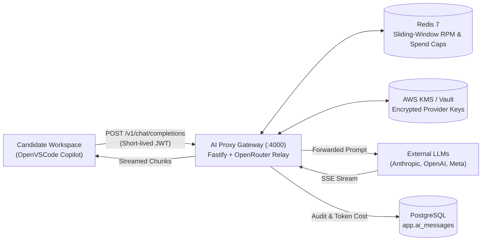
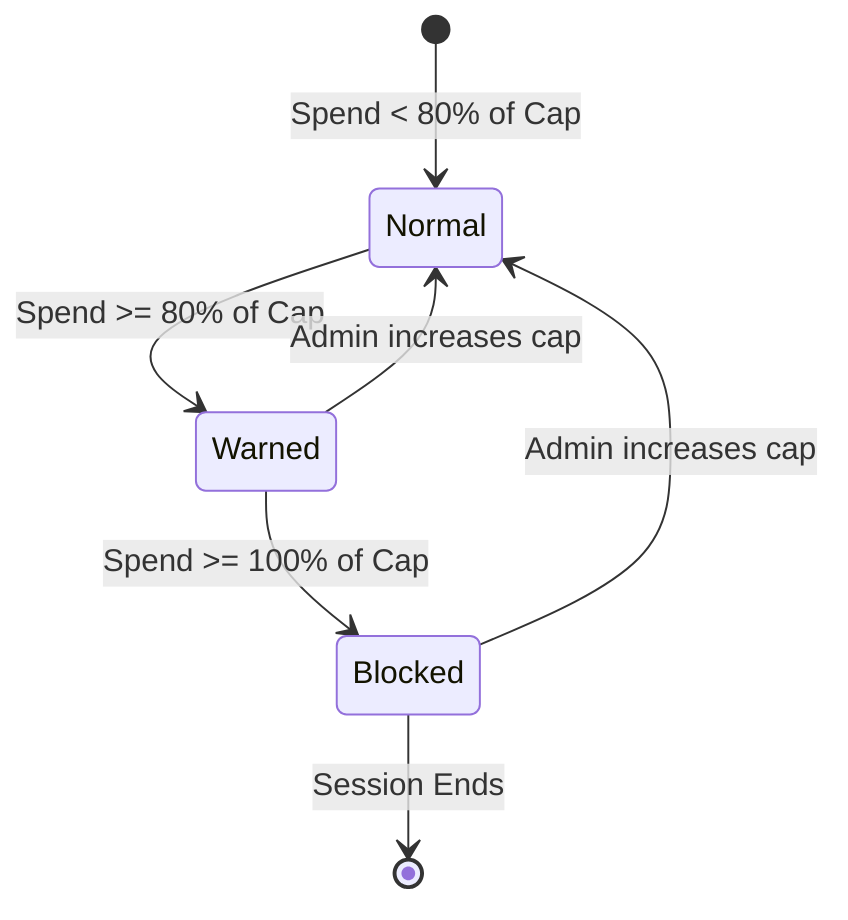
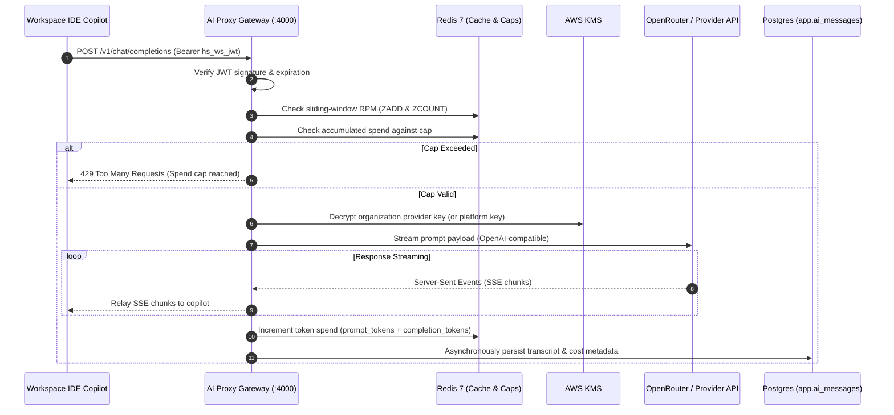

<RoleBadge roles={["sde", "ai"]} />

# AI Proxy Gateway Architecture

The **HelloSmart AI Proxy Gateway** (running as a dedicated service on port 4000) is the sole sanctioned egress point for all artificial intelligence calls originating from candidate workspaces and virtual assistant machines (BR-13, BR-14, BR-15, BR-16, BR-17).

---

## 1. Gateway Security Invariants



### Inviolable Business Invariants

1. **Short-Lived Workspace Session Token (BR-13)**: Workspaces receive a 15-minute rotating JWT signed by the control plane containing `workspace_id`, `org_id`, and `assessment_id`. Workspaces **never receive real provider API keys**.
2. **AI OFF Enforcement (BR-14)**: When an assessment disables AI tools (`ai_policy.enabled = false`), the gateway rejects requests with `403 Forbidden`, and container iptables firewalls drop outbound traffic to external LLM provider endpoints.
3. **Sliding-Window Rate Limiting (BR-15)**: Requests are constrained to an RPM limit (default 30 RPM) using Redis sorted sets.
4. **Token & Dollar Budget Caps (BR-15)**: Every input and output token is tracked against session spend limits ($2.00 default for Short tasks). At 80%, a warning banner is delivered to the candidate; at 100%, requests are blocked with RFC 7807 `429 Too Many Requests`.
5. **BYOK Key Encryption at Rest (BR-16)**: Customer-provided LLM keys (`ProviderKey`) are encrypted via AWS KMS envelopes and decrypted only in ephemeral memory inside the proxy. Full keys are never returned over the API.
6. **Platform Key Allocation (BR-17)**: When an organization does not supply BYOK keys, Platform Admins can manually allocate a capped platform key (`PlatformKeyAllocation`) for Chat workspaces.
7. **Prompt/Response Telemetry (BR-18)**: Complete transcripts, token counts, model identifiers, and latency metrics are persisted to `app.ai_messages` for automated reviewer agent analysis.

---

## 2. Spend Cap Policy Specification (`@hs/contracts/ai-proxy`)

The proxy enforces budget control using the `AiProxySpendCapPolicy` contract:

```typescript
export interface AiProxySpendCapPolicy {
  assessment_id: string;
  workspace_id: string;
  currency: 'USD';
  cap_dollars: number; // e.g. 2.50
  warn_threshold_pct: number; // default: 80
  hard_cap_action: 'warn_then_block' | 'block';
  rpm_limit: number; // default: 30
  allowed_models: string[]; // e.g. ['anthropic/claude-3-5-sonnet', 'openai/gpt-4o']
}
```

### Spend Cap State Machine



- **Normal (`Spend < 80% of Cap`)**: Requests pass without friction. Header `X-HelloSmart-Spend-Remaining` indicates budget.
- **Warned (`80% of Cap <= Spend < 100% of Cap`)**: Response includes warning header `X-HelloSmart-Spend-Warning: threshold_reached`. The frontend displays an alert to the candidate.
- **Blocked (`Spend >= 100% of Cap`)**: Proxy immediately rejects request with HTTP 429:
  ```json
  {
    "type": "https://api.hellosmart.ai/errors/spend-cap-exceeded",
    "title": "AI Spend Cap Exceeded",
    "status": 429,
    "detail": "Workspace AI spend limit of $2.50 has been reached. Consult your assessment coordinator.",
    "instance": "/v1/chat/completions"
  }
  ```

---

## 3. Proxy Request Lifecycle & OpenRouter Relay


