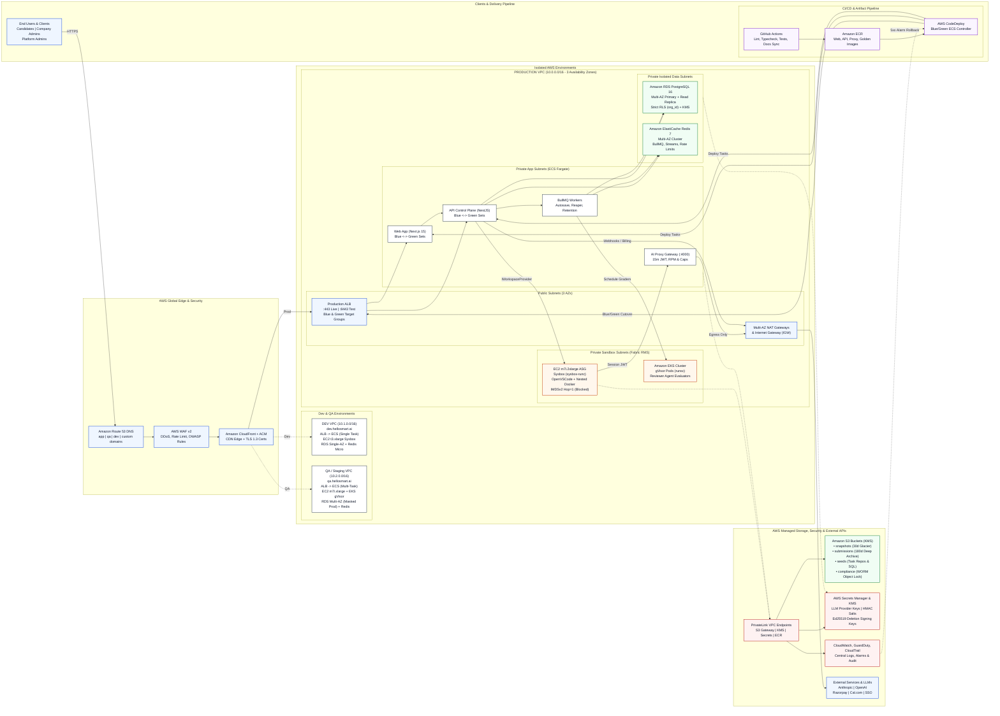
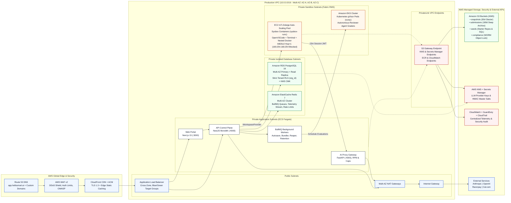
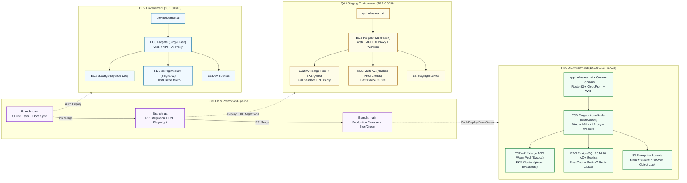
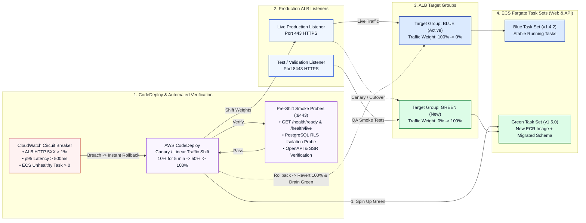

<RoleBadge roles={["sde", "ai", "qa", "mgmt"]} />

This blueprint documents the target **one-time AWS infrastructure provisioning** for HelloSmart.ai across **Dev**, **QA**, and **Production** environments. Every diagram below includes both a high-resolution static export (**PNG** and vector **SVG** download links for external decks and DevOps kickoff reviews) and an interactive zoomable **Mermaid** view.

<Callout type="info" title="Architecture Artifacts in Repo">
Raw high-DPI `.png` and `.svg` source exports are also version-controlled inside `docs/architecture/aws-migration/` for offline sharing alongside this portal.
</Callout>

---

## 1. End-to-End AWS Architecture Overview

The complete system view connects DNS/Edge (**Route 53**, **WAF v2**, **CloudFront + ACM**), CI/CD (**GitHub Actions**, **Amazon ECR**, **AWS CodeDeploy**), isolated **Dev** (`10.1.0.0/16`), **QA** (`10.2.0.0/16`), and **Production Multi-AZ** (`10.0.0.0/16`) VPCs, **HelloSmart Fabric RMS** dual-runtime sandboxes (`Sysbox` + `gVisor`), **PrivateLink** internal AWS service endpoints, **Amazon S3**, **Secrets Manager + KMS**, and centralized observability (**CloudWatch**, **GuardDuty**, **CloudTrail**).

<Tabs items={['High-Res Diagram (PNG)', 'Interactive Mermaid']}>
  <Tab value="High-Res Diagram (PNG)">
    

      
    

    

      Downloads:{' '}
      <a href="/diagrams/aws-migration/00-complete-aws-architecture.png" download className="font-medium underline">
        Download PNG (4026x1760)
      </a>{' '}
      |{' '}
      <a href="/diagrams/aws-migration/00-complete-aws-architecture.svg" download className="font-medium underline">
        Download Vector SVG
      </a>
    

  </Tab>
  <Tab value="Interactive Mermaid">

  </Tab>
</Tabs>

---

## 2. Production Multi-AZ VPC & HelloSmart Fabric Topology

The Production VPC (`10.0.0.0/16`) spans three Availability Zones (`us-east-1a`, `us-east-1b`, `us-east-1c` or equivalent primary region) and strictly separates internet-facing ALBs/NAT gateways from ECS Fargate application services, untrusted candidate sandbox hosts (`Sysbox` + `gVisor`), and zero-internet database subnets.

<Tabs items={['High-Res Diagram (PNG)', 'Interactive Mermaid']}>
  <Tab value="High-Res Diagram (PNG)">
    

      
    

    

      Downloads:{' '}
      <a href="/diagrams/aws-migration/01-master-aws-production-vpc.png" download className="font-medium underline">
        Download PNG (3150x1147)
      </a>{' '}
      |{' '}
      <a href="/diagrams/aws-migration/01-master-aws-production-vpc.svg" download className="font-medium underline">
        Download Vector SVG
      </a>
    

  </Tab>
  <Tab value="Interactive Mermaid">

  </Tab>
</Tabs>

### Production VPC Network Tiering (`10.0.0.0/16`)

| Subnet Tier | Route Table / Egress Policy | Hosted Workloads | Isolation Guarantees |
|---|---|---|---|
| **Public Subnets** (3 AZs) | Default route `0.0.0.0/0` via IGW | Multi-AZ ALB, Multi-AZ NAT Gateways | No application compute or candidate workloads allowed in public subnets. |
| **Private Application Subnets** | Outbound only via NAT Gateway and PrivateLink | ECS Fargate (`apps/web`, `apps/api`, AI Proxy, BullMQ Workers) | Only reachable from ALB Security Group on service ports. |
| **Private Sandbox Subnets** | Strictly blocked from Data Subnets; allowed to AI Proxy & S3 Endpoint only | EC2 `m7i.2xlarge` Sysbox ASG + EKS `gVisor` Worker Nodes | **IMDSv2 `HopLimit=1`** blocks inner containers from reading `169.254.169.254` host IAM credentials. |
| **Private Isolated Data Subnets** | Local VPC routes only (`no IGW`, `no NAT` routes) | RDS PostgreSQL 16 Multi-AZ + ElastiCache Redis 7 | Accessible solely by Private App Subnets on ports `5432` and `6379`. |

---

## 3. Environment Promotion: Dev, QA, and Production

GitHub branches map 1:1 to isolated VPCs (or sub-accounts under AWS Organizations), ensuring candidate evaluation sandboxes and schema migrations are battle-tested in QA before Blue/Green cutover in Production.

<Tabs items={['High-Res Diagram (PNG)', 'Interactive Mermaid']}>
  <Tab value="High-Res Diagram (PNG)">
    

      
    

    

      Downloads:{' '}
      <a href="/diagrams/aws-migration/02-dev-qa-prod-environments.png" download className="font-medium underline">
        Download PNG (1636x1508)
      </a>{' '}
      |{' '}
      <a href="/diagrams/aws-migration/02-dev-qa-prod-environments.svg" download className="font-medium underline">
        Download Vector SVG
      </a>
    

  </Tab>
  <Tab value="Interactive Mermaid">

  </Tab>
</Tabs>

---

## 4. Production Blue/Green Deployment & Circuit Breaker

Zero-downtime releases for both **Web (`apps/web`)** and **API (`apps/api`)** run via **AWS CodeDeploy** on ECS Fargate, pairing expand-and-contract database migrations with isolated `:8443` smoke validation and CloudWatch alarm circuit breakers.

<Tabs items={['High-Res Diagram (PNG)', 'Interactive Mermaid']}>
  <Tab value="High-Res Diagram (PNG)">
    

      
    

    

      Downloads:{' '}
      <a href="/diagrams/aws-migration/03-blue-green-deployment.png" download className="font-medium underline">
        Download PNG (2009x575)
      </a>{' '}
      |{' '}
      <a href="/diagrams/aws-migration/03-blue-green-deployment.svg" download className="font-medium underline">
        Download Vector SVG
      </a>
    

  </Tab>
  <Tab value="Interactive Mermaid">

  </Tab>
</Tabs>

### Traffic Cutover & Circuit Breaker Thresholds

1. **Green Provisioning & Expand Migration:** Backward-compatible PostgreSQL expand migrations run prior to image swap; CodeDeploy spins up the **Green** ECS Task Set cleanly against the existing schema.
2. **Pre-Shift Validation (`:8443`):** Internal synthetic checks verify `/api/v1/health/ready`, `/api/v1/health/live`, PostgreSQL Row-Level Security probes, OpenAPI integrity, and SSR page rendering on the test listener before any live customer sees Green.
3. **Canary / Linear Shift (`:443`):** CodeDeploy routes **10% traffic for 5 minutes**, expands to **50%**, and completes at **100%**.
4. **Automatic Circuit Breaker Rollback:** If CloudWatch detects **ALB HTTP 5XX greater than 1%**, **p95 API latency above 500 ms**, or **any unhealthy ECS task**, CodeDeploy reverts **100% of traffic to Blue in seconds** without rebuilding or re-deploying.
5. **Drain Delay:** Blue tasks remain warm for **15 minutes** post-100% cutover to cover instantaneous manual or automated rollback windows before ECS drains and terminates them.

---

## 5. AWS Implementation Specifications

| Tier | AWS Service | Production Sizing & Configuration | Key Security & Operational Invariants |
|---|---|---|---|
| **DNS & CDN** | Route 53 + CloudFront + ACM | Wildcard & white-label custom domains (`*.hellosmart.ai`), TLS 1.3 | Edge static caching and global low-latency termination. |
| **WAF & Shield** | AWS WAF v2 | Managed OWASP Top 10, Bot Control, IP rate limits on `/auth/*` | Blocks credential stuffing and Layer 7 attacks prior to ALB. |
| **Ingress** | Application Load Balancer | Dual-stack, cross-zone, Blue/Green Target Groups | Listeners `:443` (Production) and `:8443` (Blue/Green Verification). |
| **Web & API** | Amazon ECS (Fargate) | `apps/web` (`Next.js 15`) & `apps/api` (`NestJS`) Multi-AZ auto-scaling | Blue/Green task sets; private subnets only (no public IPs). |
| **AI Proxy** | Amazon ECS (Fargate) | FastAPI / Node (`:4000`), Auto-Scaling | **Sole LLM egress path (BR-13)**; resolves real keys from Secrets Manager. |
| **Workers** | Amazon ECS (Fargate) | BullMQ Consumers (Autosave, Bundler, Reaper, Retention) | Processes S3 snapshots, GDPR anonymization, and telemetry batches. |
| **Interactive IDEs** | EC2 Auto-Scaling Group | `m7i.2xlarge` Ubuntu hosts + **Sysbox (`sysbox-runc`)** | Native I/O speed & nested Docker. **IMDSv2 `HopLimit=1` blocks host credential theft.** |
| **Evaluators** | Amazon EKS / Fargate | Pods scheduled with `RuntimeClass: gvisor` (`runsc`) | Isolates untrusted candidate grading code inside userspace syscalls. |
| **Database** | Amazon RDS PostgreSQL 16 | Multi-AZ Primary + Standby + Read Replica, KMS CMK | Enforces Row-Level Security (`org_id` scoping per BR-01). |
| **Cache & Queues** | Amazon ElastiCache Redis 7 | Multi-AZ Cluster with Auto-Failover | Powers BullMQ, sliding-window RPM limiters, and activity telemetry streams. |
| **Object Storage** | Amazon S3 | 4 KMS-encrypted buckets (`snapshots`, `submissions`, `seeds`, `compliance`) | Lifecycle transitions to Glacier (`30d`/`180d`) & WORM Object Lock on compliance manifests. |
| **Private Backbone** | AWS PrivateLink (VPC Endpoints) | S3 Gateway; Interface Endpoints for KMS, Secrets Manager, ECR, Logs | Keeps internal AWS API traffic off the public internet. |
| **Secrets & Keys** | AWS Secrets Manager + KMS | Customer Managed Keys (CMK), automated rotation | Stores Anthropic/OpenAI keys, HMAC anonymization salts, and Ed25519 keys. |
| **Observability** | CloudWatch, GuardDuty, CloudTrail | Centralized JSON logs, Container Insights, 5xx/latency alarms | Alarms trigger immediate CodeDeploy Blue/Green rollback. |

---

## 6. Architectural Non-Negotiables for Provisioning

<Callout type="warn" title="Strict Security Controls (Must Validate Before Go-Live)">
Verify every control below before onboarding enterprise customer traffic onto Production AWS.
</Callout>

1. **Block Container Access to Host IAM (`IMDSv2 HopLimit=1`):** Enforce `HttpPutResponseHopLimit = 1` on every EC2 Launch Template backing the Sysbox ASG so inner candidate containers cannot reach `169.254.169.254` to steal host IAM credentials.
2. **Zero-Trust Sandbox Egress:** Private Sandbox Subnets (`Sysbox` + `gVisor`) have **no route** to Private Data Subnets (`RDS` or `ElastiCache`). Candidate code reaches external LLMs solely via the AI Proxy using short-lived **15-minute Workspace Session JWTs** (`BR-13`).
3. **Dual Sandbox Isolation:** Keep interactive browser IDE sessions on **Sysbox (`sysbox-runc`)** EC2 hosts (needed for full nested Docker-in-Docker & OpenVSCode I/O) and isolate automated submission grading runs on **EKS `gVisor` (`runsc`)** pods so untrusted test binaries never share host kernel syscalls.
4. **PrivateLink for Internal AWS Calls:** Route S3, ECR image pulls, Secrets Manager lookups, KMS decryption, and CloudWatch log shipping through VPC Interface/Gateway Endpoints so sensitive data never touches the public internet or wastes NAT bandwidth.
5. **Tenant Data Isolation (`BR-01`) + Encryption at Rest:** Enforce PostgreSQL Row-Level Security (`org_id`) in RDS alongside customer-managed KMS encryption across RDS, ElastiCache, EBS volumes, Secrets Manager, and all 4 S3 buckets.
6. **Compliance WORM Retention:** Enable **S3 Object Lock (WORM)** on the `compliance` bucket so signed Ed25519 deletion certificates remain tamper-proof for statutory audit periods even after GDPR anonymization purges candidate PII from RDS.

