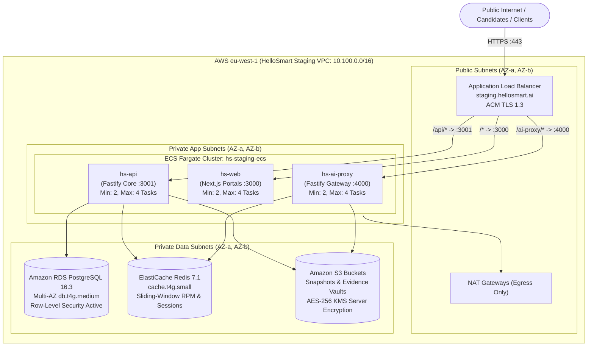

<RoleBadge roles={["sde", "mgmt"]} />

# AWS Staging Infrastructure & Deployment

The HelloSmart Staging environment is deployed into AWS Region `eu-west-1` (Ireland) via declarative Infrastructure-as-Code using **Terraform** (`infra/terraform/envs/staging`).

The architecture provides high availability, strict network segmentation, and automated CI/CD deployment pipelines matching production topologies while maintaining strict cost control.

---

## 1. Staging Network & Service Topology



---

## 2. Infrastructure Components Specification

### 1. Networking & VPC Layout
- **CIDR Block**: `10.100.0.0/16`
- **Subnet Allocation**:
  - `Public Subnets` (`10.100.1.0/24`, `10.100.2.0/24`): Holds Internet-facing ALB and Dual-AZ NAT Gateways.
  - `Private App Subnets` (`10.100.10.0/24`, `10.100.20.0/24`): Holds ECS Fargate container tasks; no public IP addresses assigned.
  - `Private Data Subnets` (`10.100.30.0/24`, `10.100.40.0/24`): Holds RDS database and ElastiCache Redis nodes with isolated security groups.

### 2. Application Load Balancer (ALB) Routing
- **Hostname**: `staging.hellosmart.ai`
- **SSL/TLS**: Managed via AWS Certificate Manager (ACM) enforcing TLS 1.3.
- **Path-Based Routing Rules**:
  - `/api/*`: Routed to `hs-api` target group (Fastify backend on port 3001).
  - `/ai-proxy/*`: Routed to `hs-ai-proxy` target group (AI Gateway on port 4000).
  - `/*`: Routed to `hs-web` target group (Next.js candidate & company portals on port 3000).

### 3. ECS Fargate Cluster (`hs-staging-ecs`)
Containerized microservices run on serverless AWS Fargate:
- **`hs-api`**: 1 vCPU / 2048 MB memory; auto-scales based on CPU utilization and request count.
- **`hs-web`**: 1 vCPU / 2048 MB memory; serves Next.js SSR and client portals.
- **`hs-ai-proxy`**: 1 vCPU / 2048 MB memory; dedicated egress proxy for LLM requests.

### 4. Persistence & Storage Layer
- **Amazon RDS PostgreSQL 16.3**:
  - Multi-AZ deployment with automatic failover.
  - Storage: 100 GB gp3 with storage autoscaling up to 500 GB.
  - Database level Row-Level Security (RLS) enabled on all tenant-owned tables.
- **Amazon ElastiCache Redis 7.1**:
  - In-memory data store for sliding-window rate limiting, token spend tracking, and BullMQ background task queues.
  - Encryption in transit (TLS) and encryption at rest enabled.
- **Amazon S3 Evidence Buckets**:
  - `hs-staging-snapshots`: Candidate workspace 30s RPO tarballs.
  - `hs-staging-submissions`: Final candidate Git diffs and evaluation artifacts.
  - Strict lifecycle policies transitioning cold snapshots to Glacier after 90 days (BR-01, retention limits).

---

## 3. Terraform Deployment Workflow

The staging environment is managed via Terraform under `infra/terraform/envs/staging`:

```bash
# 1. Initialize Terraform providers and backend
cd infra/terraform/envs/staging
terraform init

# 2. Review infrastructure execution plan
terraform plan -out=staging.tfplan

# 3. Apply infrastructure modifications
terraform apply staging.tfplan
```

### GitHub Actions Deployment Pipeline
CI/CD deployments to staging execute automatically when changes merge into the `dev` branch:
1. Docker images are built and pushed to Amazon ECR (`hs-api`, `hs-web`, `hs-ai-proxy`).
2. Terraform applies database migrations via an ephemeral ECS task.
3. ECS services execute a zero-downtime rolling update deployment.
4. Health checks verify HTTP 200 responses on `/health` before traffic migration.
