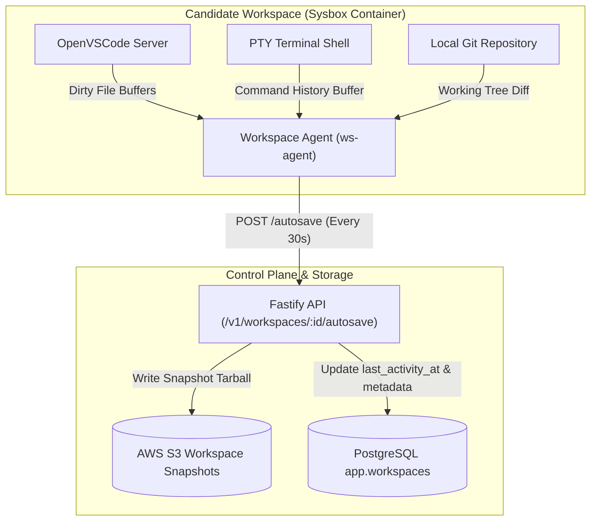
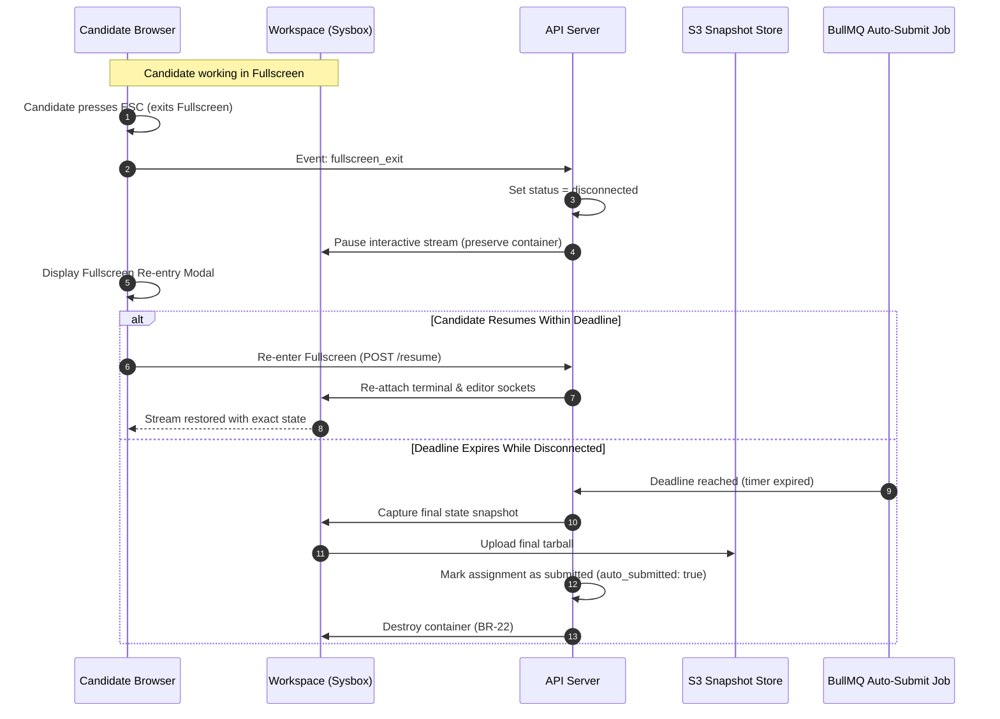

<RoleBadge roles={["sde", "qa"]} />

# Candidate Workspace Autosave & State Restoration Engine

Candidates completing hands-on technical assessments work inside a sandboxed Sysbox container environment running OpenVSCode server, bash terminal sessions, local development databases, and the AI copilot assistant.

Because candidate assessments are high-stakes, time-constrained environments, HelloSmart implements a resilient **Continuous State Persistence & Autosave Engine** guaranteeing an **RPO (Recovery Point Objective) of at most 30 seconds** (BR-11) coupled with rigorous integrity enforcement (BR-09, BR-10).

---

## 1. Autosave Architecture & Contracts

The candidate workspace daemon (`ws-agent`) continuously monitors workspace mutations and dispatches delta snapshots to the control plane every 30 seconds or upon explicit events.



### Snapshot Payload Schema (`@hs/contracts/autosave`)

```typescript
export interface CandidateAutosavePayload {
  workspace_id: string;
  assignment_id: string;
  timestamp: string; // UTC ISO 8601
  sequence_number: number;
  dirty_files: Array<{
    file_path: string;
    content: string;
    cursor_position?: { line: number; column: number };
  }>;
  git_state: {
    branch: string;
    head_commit: string;
    uncommitted_diff: string;
    staged_diff: string;
  };
  terminal_state: {
    active_command?: string;
    recent_history: string[];
    exit_codes: Record<string, number>;
  };
  active_tab?: string;
}
```

---

## 2. Inviolable Integrity & Timing Rules

### 1. Fullscreen Enforcement & Anti-Cheat Disconnect (BR-10)
- Upon connecting to a Cloud VM assessment, the candidate portal requests fullscreen mode (`element.requestFullscreen()`).
- Browsers cannot natively block a user from pressing `ESC` or leaving fullscreen.
- Therefore, the client actively listens to `fullscreenchange` events. If the candidate exits fullscreen:
  1. The workspace WebSocket session is immediately **disconnected** on the client and server.
  2. The candidate workspace status transitions to `disconnected` (the container is preserved, not destroyed).
  3. An `ActivityEvent` with type `fullscreen_exit` is appended to the audit log.
  4. A full-screen resume modal is displayed, requiring the candidate to re-engage fullscreen before continuing work.

### 2. Disconnect Countdown Continuation (BR-09)
- By default, the assessment countdown timer **keeps running while disconnected**.
- `pause_timer_on_disconnect` is an assessment-level configuration flag that defaults to **`false`**.
- The candidate consent screen explicitly displays this rule before workspace provisioning (BR-12).
- Server-side schedulers evaluate deadlines against `deadline_at` regardless of socket disconnect status. If time expires while disconnected, the background scheduler automatically triggers **Auto-Submission** (`submitted_at = now()`, `auto_submitted = true`).

### 3. State Restoration on Resume (BR-11)
- When a candidate re-connects after a browser crash, network drop, or fullscreen exit:
  1. The orchestrator validates that the current time is before the deadline (`now()` prior to `deadline_at`) and the assignment is in `in_progress` or `disconnected`.
  2. The container is reattached; if the container was recycled due to idle timeout, a warm container is provisioned and hydrated with the latest S3 snapshot (`final_snapshot_ref`).
  3. Dirty file buffers, editor cursor positions, and terminal history are restored to the exact pre-disconnect state.

---

## 3. Disconnect and Auto-Submit Flow


