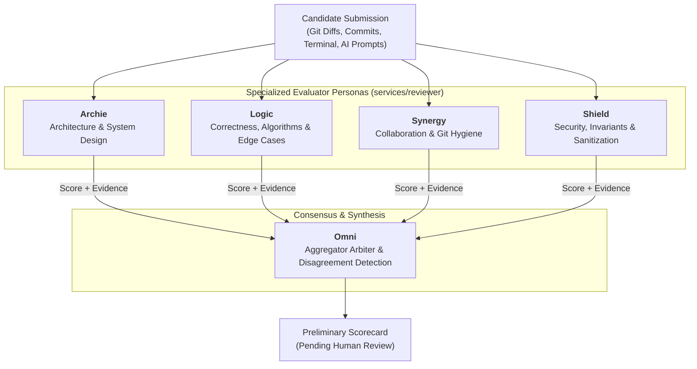
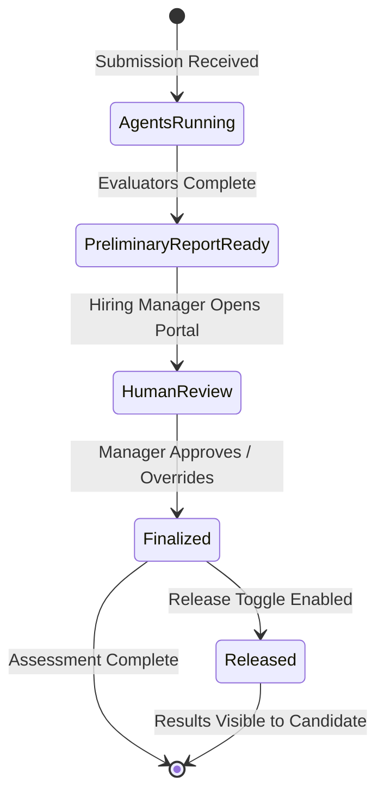

<RoleBadge roles={["sde", "ai", "qa"]} />

# Autonomous Reviewer Agent Pipeline

HelloSmart replaces generic, monolithic AI grading with an orchestration of **independent specialized reviewer agents** (`services/reviewer`). Each agent observes the candidate's work across a distinct rubric dimension and cites deterministic evidence before generating scores.

---

## 1. Specialized Evaluator Personas

The evaluation engine dispatches candidate submission artifacts (Git diffs, commit histories, terminal logs, and AI conversation transcripts) to 5 specialized reviewer personas:



### Personas and Evaluation Dimensions

| Persona | Evaluation Focus | Analyzed Artifacts | Red Flags Detected |
|---|---|---|---|
| **Archie** (Architecture) | Modularity, separation of concerns, coupling, design pattern adherence, and database schema discipline. | File organization, interface definitions, dependency trees. | God classes, circular imports, leaked abstractions, hardcoded config. |
| **Logic** (Correctness) | Algorithmic efficiency, time/space complexity, edge case handling, and implementation completeness against requirements. | Source code implementations, unit/integration test results. | Off-by-one errors, unhandled nulls, concurrency race conditions, infinite loops. |
| **Synergy** (Git & Collaboration) | Commit message hygiene, logical patch slicing, clean branching, and developer workflow discipline. | `git log`, git diff chunks, commit intervals. | Megacommit with message "wip", unformatted code, commit history rewrites. |
| **Shield** (Security & Invariants) | Vulnerability identification (OWASP Top 10), secrets detection, input sanitization, and invariant compliance. | Source code, configuration files, environment variables. | SQL injection, hardcoded credentials, unvalidated inputs, bypassed auth. |
| **Omni** (Aggregator Arbiter) | Synthesizes scores from Archie, Logic, Synergy, and Shield; evaluates cross-agent score variance; identifies conflicting assessments. | All individual agent scores, confidence metrics, and evidence citations. | High variance (variance > 1.5) across agents triggering `flagged_disagreement`. |

---

## 2. Mandatory Evidence Citation Protocol (BR-19)

In accordance with **BR-19**, no reviewer agent may emit a numerical score without concrete, reproducible evidence citations. Unsubstantiated claims or hallucinatory scores are rejected by the validator.

### Evidence Citation Schema (`@hs/contracts/agent-evaluation`)

```typescript
export interface RubricEvidenceCitation {
  file_path: string; // e.g. "src/ledger/transaction.ts"
  start_line: number; // e.g. 42
  end_line: number; // e.g. 58
  code_snippet: string; // Verbatim snippet of candidate code
  rationale: string; // Detailed technical reasoning connecting snippet to score
}

export interface AgentDimensionScore {
  agent_id: 'archie' | 'logic' | 'synergy' | 'shield';
  dimension_name: string;
  score: number; // Scale 1 to 5
  confidence: number; // Scale 0.0 to 1.0
  citations: RubricEvidenceCitation[];
  red_flags: string[];
}
```

Example Evidence Output:
```json
{
  "agent_id": "logic",
  "dimension_name": "Idempotent Transaction Handling",
  "score": 4,
  "confidence": 0.95,
  "citations": [
    {
      "file_path": "src/ledger/transaction.ts",
      "start_line": 54,
      "end_line": 61,
      "code_snippet": "const existingTx = await db('transactions').where({ idempotency_key }).first();\nif (existingTx) return existingTx;",
      "rationale": "Candidate properly implemented an idempotency key check against the transactions table before initiating ledger mutation."
    }
  ],
  "red_flags": []
}
```

---

## 3. Human-in-the-Loop & Immutable Versioning



### Inviolable Governance Rules

1. **Human Makes the Final Call (BR-18, BR-20)**: Agent scores and red flags are evidence for a human evaluator. The platform **never auto-rejects candidates** based on automated agent scores.
2. **Versioned Score Overrides (BR-20)**: Hiring managers may adjust any score or rubric weight. Every modification increments the review version (`ReviewVersion`), storing the editor's user ID, timestamp, and mandatory written rationale. Prior versions are immutable.
3. **Controlled Candidate Release (BR-21)**: Scorecards remain strictly private to the hiring company unless the company explicitly toggles the release switch. Candidates cannot access results until release is toggled.
