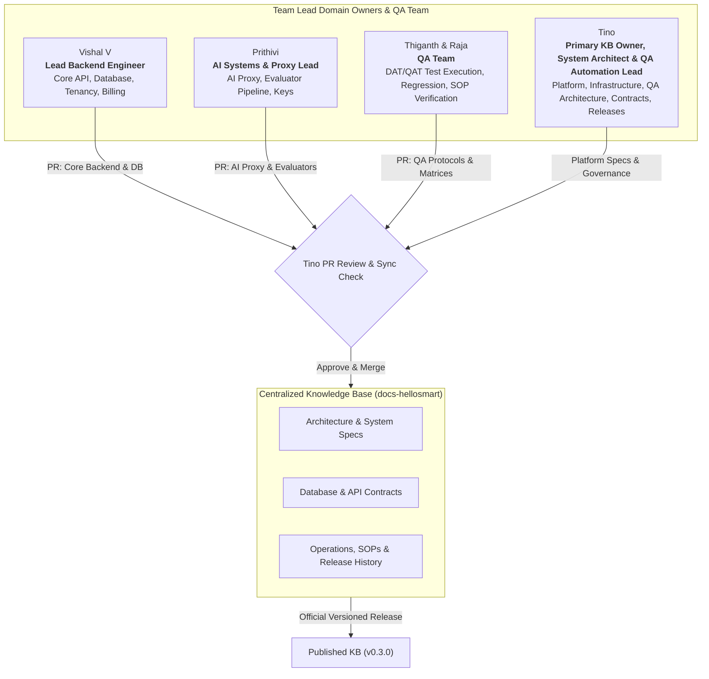
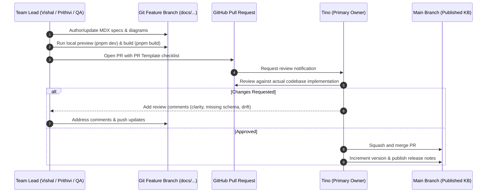

<RoleBadge roles={["mgmt", "sde", "ai", "qa"]} />

# Knowledge Base Governance & Contribution Framework

The **HelloSmart.ai Centralized Product Knowledge Base** (`docs-hellosmart`) is the authoritative **Single Source of Truth (SSOT)** for product requirements, system architecture, database schemas, API contracts, deployment infrastructure, and release history.

Documentation is a **shared, collaborative engineering responsibility across all Team Leads**, rather than an isolated task. Every architectural evolution, schema migration, or new service feature in the monorepo must be accompanied by corresponding documentation updates in this repository.

---

## 1. Governance & Ownership Matrix

To ensure documentation remains accurate, comprehensive, and synchronized with actual production code, documentation ownership is distributed across Team Leads by technical domain, with primary coordination and release authority held by **Tino**.



### Domain Ownership Roster

| Member | Primary Engineering Role | KB Domain Ownership | Monorepo Codebase Paths | KB Documentation Paths |
|---|---|---|---|---|
| **Tino** | **System Architect, Platform Lead & QA Automation Lead** *(KB Primary Owner)* | • Repository health, structure, and standards<br/>• Overall PR review and merge authority<br/>• QA automation architecture, SOPs & test matrices<br/>• Versioning and official KB releases<br/>• System architecture & ADRs<br/>• AWS Staging & Prod infrastructure<br/>• Shared contracts & cross-cutting schemas | `packages/contracts`<br/>`infra/terraform/*`<br/>`tests/*`<br/>`.github/*` | `/docs/architecture/*`<br/>`/docs/adr/*`<br/>`/docs/operations/knowledge-base-governance`<br/>`/docs/operations/release-history`<br/>`/docs/operations/qa-sop` |
| **Vishal V** | **Lead Backend Engineer** | • Core Fastify REST API (`apps/api`)<br/>• PostgreSQL 16 schema & Kysely queries<br/>• Multi-tenancy (BR-01) & RLS policies<br/>• Industry/Sector Task Template blueprints<br/>• Candidate onboarding & timing engine<br/>• Razorpay billing, quotes & invoices | `apps/api/*`<br/>`packages/database/*` | `/docs/database/*`<br/>`/docs/api/*`<br/>`/docs/architecture/template-taxonomy`<br/>`/docs/knowledge-base/13-quotes-payments-and-billing` |
| **Prithivi** | **AI Systems & Proxy Lead** | • Standalone AI Proxy Gateway (:4000)<br/>• Sliding-window rate limits & token caps (BR-15)<br/>• Model allowlists & AI OFF egress rules (BR-14)<br/>• Multi-Agent Reviewer pipeline (`services/reviewer`)<br/>• Evaluator personas (Archie, Logic, Synergy, Shield, Omni)<br/>• Mandatory evidence citation protocols (BR-19) | `services/ai-proxy/*`<br/>`services/reviewer/*` | `/docs/architecture/ai-proxy-gateway`<br/>`/docs/architecture/reviewer-pipeline`<br/>`/docs/roles/ai`<br/>`/docs/knowledge-base/08-ai-controls`<br/>`/docs/knowledge-base/09-reviewer-agents-and-scoring` |
| **Thiganth & Raja** | **QA Team** *(Under Tino's QA Leadership)* | • Autonomous Testing Protocols (DAT & QAT) execution<br/>• Zero-wait Prism mock test harnesses<br/>• Multi-tenant RLS isolation test suites<br/>• End-to-end regression execution | `tests/*`<br/>`apps/api/test/*` | `/docs/operations/qa-sop`<br/>`/docs/roles/qa` |

---

## 2. Responsibilities of the Primary Owner (Tino)

As the primary repository owner, **Tino** is responsible for:

1. **Repository Health & Governance**:
   - Maintaining the Next.js and Fumadocs framework configuration.
   - Establishing consistent folder layouts, navigation trees (`meta.json`), and MDX component standards.
   - Ensuring zero broken links, valid frontmatter, and correct Mermaid diagram syntax.
2. **Reviewing Incoming Pull Requests**:
   - Serving as the mandatory reviewer for all documentation PRs submitted by Team Leads.
   - Validating that proposed documentation matches actual codebase implementation (preventing documentation drift).
   - Enforcing clear explanations, exact code references, and proper role tagging (`<RoleBadge />`).
3. **Coordinating Cross-Lead Documentation**:
   - Identifying documentation gaps resulting from new features or sprint epics.
   - Requesting timely documentation contributions from Vishal V, Prithivi, and the QA team.
4. **Publishing Versioned Releases**:
   - Tracking implementation milestones and publishing official versioned releases (e.g., `v0.1.0`, `v0.2.0`, `v0.3.0`).
   - Updating `CHANGELOG.md` and `/docs/operations/release-history` with every release.
   - Tagging release commits in Git (`git tag vX.Y.Z`).

---

## 3. Responsibilities of Team Leads & QA Team (Vishal V, Prithivi, QA Team)

Every Team Lead and QA Team member is an active contributor to the Knowledge Base with the following responsibilities:

1. **Document Implementation Decisions**:
   - Author architectural explanations, schema changes, and service workflows whenever new code is merged.
   - Explain the "why" behind technical trade-offs (e.g., why OpenRouter was selected, why Kysely was chosen over Prisma, why sysbox containers were adopted).
2. **Synchronize Code & Contracts**:
   - When modifying database tables or migrations in `packages/database`, update `/docs/database/db-visualization`.
   - When modifying OpenAPI specs in `packages/contracts`, update `/docs/api/overview`.
   - When introducing new environment variables or service configurations, update relevant setup guides.
3. **Submit via Standard PR Workflow**:
   - Never commit directly to `main`.
   - Create a dedicated branch following the naming convention: `docs/<lead-name>-<feature-topic>`.
   - Submit a Pull Request using the repository's PR template and request review from Tino.
4. **Resolve Review Feedback**:
   - Address any clarity, formatting, or consistency comments raised during review within the 4-hour review SLA.

---

## 4. Collaborative PR & Review Workflow



### Step-by-Step Procedure

#### Step 1: Branch Creation
Create a branch from `main`:
```bash
git checkout main
git pull origin main
git checkout -b docs/<your-name>-<topic>

# Examples:
# git checkout -b docs/vishal-database-kysely-sync
# git checkout -b docs/prithivi-ai-proxy-spend-caps
# git checkout -b docs/qa-dat-qat-protocols
```

#### Step 2: Authoring & Verification
1. Author or update the target `.mdx` files in `content/docs/`.
2. Ensure every new page has valid YAML frontmatter:
   ```yaml
   ---
   title: "Feature or System Name"
   description: "One-sentence executive summary of the document."
   ---
   ```
3. Include the appropriate role badge right below the frontmatter:
   ```tsx
   <RoleBadge roles={["sde", "ai"]} />
   ```
4. If adding a new page, register its slug in the corresponding directory's `meta.json`.
5. Verify locally:
   ```bash
   pnpm dev     # Preview on http://localhost:3002
   pnpm build   # Verify clean Next.js static generation
   ```

#### Step 3: Raising the Pull Request
Submit the PR targeting `main` with the title formatted as:
```
docs(<scope>): <short description of update>

# Examples:
# docs(ai-proxy): document sliding-window token caps and BYOK KMS flow
# docs(database): sync Sprint 2 candidate autosave tables
```
Fill out the standard PR template, linking the relevant monorepo PRs or Zoho sprint tickets.

#### Step 4: Tino's Review Gate
Tino verifies:
- **Accuracy**: Does the document accurately reflect what was merged into the monorepo?
- **Tenancy Compliance**: Are multi-tenancy invariants (BR-01, org-scoping) clearly documented?
- **Formatting**: Are diagrams valid Mermaid? Are callouts, tabs, and tables formatted properly?
- **Completeness**: Are environment variables, error codes, and edge cases clearly stated?

Upon approval, Tino merges the PR into `main`.

---

## 5. Versioning & Release Lifecycle

The Knowledge Base follows Semantic Versioning (`vMAJOR.MINOR.PATCH`):

| Release Tier | Frequency / Trigger | Examples | Publisher |
|---|---|---|---|
| **Major (`v1.0.0`)** | Platform milestones (e.g., MMP Launch, Phase 2) | Official MMP release with all 33 BR rules live | Tino |
| **Minor (`v0.X.0`)** | Bi-weekly sprint milestones consolidating team features | `v0.1.0` (Sprint 0), `v0.2.0` (Sprint 1), `v0.3.0` (Sprint 2) | Tino |
| **Patch (`v0.X.Y`)** | Urgent errata, typo corrections, minor schema tweaks | `v0.3.1` (fix port reference) | Tino |

### Release Publication Checklist

Whenever a sprint milestone is reached or significant architectural changes are consolidated:
1. Update `/docs/operations/release-history` with the new version, date, and change breakdown.
2. Update the root `CHANGELOG.md`.
3. Update `package.json` version string.
4. Tag the commit:
   ```bash
   git tag -a v0.3.0 -m "Release v0.3.0: Sprint 2 Architecture & Governance"
   git push origin v0.3.0
   ```
5. Notify the engineering team in the communication channel with the release changelog summary.
