<RoleBadge roles={["qa", "sde"]} />

# Autonomous Testing Protocols: DAT & QAT Execution Tracks

To ensure rapid engineering velocity without compromising software reliability or multi-tenant security invariants, HelloSmart decouples testing into two autonomous, parallel execution tracks:
1. **Developer Autonomous Testing (DAT)**: Executed by software development engineers prior to raising Pull Requests.
2. **QA Autonomous Testing (QAT)**: Executed by QA automation engineers for deep regression, multi-tenancy verification, and release sign-off.

---

## 1. Decoupled Testing Tracks

```mermaid
flowchart LR
    subgraph SDE["Track 1: Developer Autonomous Testing (DAT)"]
        Unit["Unit & Component Tests<br/>(pnpm test)"]
        Contracts["Contract Conformance<br/>(OpenAPI & Zod Schemas)"]
        Mocks["Prism Mock Harness<br/>Zero-Wait Response"]
    end

    subgraph QA["Track 2: QA Autonomous Testing (QAT)"]
        Tenancy["Strict RLS Verification<br/>(pnpm test:tenancy)"]
        E2E["Playwright User Journeys<br/>(Fullscreen & Auto-submit)"]
        Chaos["Network Drop & Resume<br/>(30s RPO Validation)"]
    end

    FeatureCode["Feature Branch"] --> SDE
    SDE --> PR["Pull Request to dev"]
    PR --> QA
    QA --> Signoff["Release Sign-off to Main"]
```



### Track Comparison & Scope

| Attribute | Track 1: DAT (Developer Autonomous Testing) | Track 2: QAT (QA Autonomous Testing) |
|---|---|---|
| **Primary Owner** | SDE Authors (Vishal, SDE-1, SDE-2) | QA Automation Lead (Tino) & QA Team (Thiganth, Raja) |
| **Execution Trigger** | Local feature development & pre-PR verification | Nightly regression runs, staging deployments, release candidate gates |
| **Execution Speed** | Fast (under 60 seconds total suite) | Deep (under 15 minutes comprehensive suite) |
| **Dependency Model** | Zero external dependencies; uses Prism mock server & in-memory databases | Live staging environment or Docker Compose with real PostgreSQL & Redis |
| **Key Invariants Tested** | API contract compliance, status machine transitions, spend cap triggers | Strict multi-tenancy (BR-01), 404 cross-tenant isolation, 30s autosave RPO |

---

## 2. Track 1: DAT Execution Protocol

Developers must complete the DAT protocol before opening any PR touching `apps/api`, `apps/web`, or `services/*`:

### Step 1: Start Mock Server
To enable zero-wait development without depending on running backend databases:
```bash
# Start Prism OpenAPI mock server
pnpm mock
```

### Step 2: Run AST Multi-Tenant Linter
Verify that all database queries explicitly filter by `org_id`:
```bash
node scripts/tenant-lint.js
```
The AST linter scans all Kysely query builders and Fastify route handlers, failing if any database query lacks tenant scoping.

### Step 3: Run Unit & Contract Suites
```bash
pnpm test
```

---

## 3. Track 2: QAT Execution Protocol

The QA automation team executes comprehensive regression suites against the Docker or staging environment:

### Step 1: Environment Spin-Up
```bash
# Provision isolated local PostgreSQL 16 and Redis 7 containers
pnpm infra:up
pnpm db:migrate
pnpm db:seed
```

### Step 2: Multi-Tenancy Invariant Verification (BR-01)
Run the dedicated cross-tenant penetration test suite:
```bash
pnpm test:tenancy
```
Assertions verified:
- Org B attempting to read Org A's candidate returns HTTP 404 (not 403, preventing resource enumeration).
- Org B attempting to view Org A's private template returns HTTP 404 (BR-02).
- Candidate attempting to access administrative API endpoints returns HTTP 403 (BR-25).

### Step 3: Workspace Lifecycle & Auto-Submit Verification
Simulate candidate sessions:
1. Candidate connects to workspace and accepts consent (BR-12).
2. Client triggers fullscreen exit; verify session transitions to `disconnected` and logs `fullscreen_exit` event (BR-10).
3. Candidate reconnects; verify workspace state, dirty files, and terminal logs restore completely (BR-11).
4. Fast-forward timer past `deadline_at`; verify background worker auto-submits assignment and destroys container (BR-08, BR-22).

---

## 4. Test Reporting & Gatekeeping

The QA team publishes test run results directly into the release runbook (`/docs/production/release-runbook`) under QA Automation Lead (Tino) oversight:
- All test suites must maintain **100% pass rate** on release branches.
- Any regression in multi-tenant isolation (BR-01) is treated as a **P0 security blocker** halting deployments.
